# AnyPII

English | [简体中文](README.zh-CN.md)

**Arbitrary natural-language policy-driven PII redaction. Readout only. No generated text.**

AnyPII is a local C++ service for text anonymization, built on
[llama.cpp](https://github.com/ggml-org/llama.cpp). Each request supplies the
text, a policy written in ordinary natural language, and a map of typed entity
definitions. The policy is used as context exactly as written; it is not parsed
into a fixed rule schema. The types are defined entirely by the request.

AnyPII proposes candidate spans, reads each type and redaction decision from
restricted next-token logits, and returns the redacted text together with
structured spans. The main path is **prefill only**: one shared context prefix,
one branch per unique candidate, multi-sequence decode, and zero generated
tokens. `redacted_text` is assembled from the original string using the returned
spans, not generated by the model.

CPU inference is the default. CUDA, Vulkan, ROCm, and Metal builds are optional.

## Quick start

Build and serve:

```sh
./build.sh
./run.sh --model /path/to/Qwen3.5-0.8B-Q8_0.gguf --port 8080
```

Redact a medical note with five request-defined types:

```sh
curl -s http://127.0.0.1:8080/v1/anypii \
  -H 'Content-Type: application/json' \
  -d '{
    "state": {
      "text": "患者陈思远因肺炎入院。主治医师林婉清、责任护士周雅琴。予阿莫西林（商品名阿莫仙，辉瑞制药）抗感染。",
      "policy": "打码患者姓名；不要打码医生与护士姓名；打码药厂名、药物品牌名与商品名；保留药品通用名。"
    },
    "types": {
      "patient_name": {"description": "患者或患儿的姓名，不是医务人员。", "redact": true},
      "clinician_name": {"description": "医生、护士、药师等医务人员姓名。", "redact": false},
      "pharma_company": {"description": "药厂、制药企业名称。", "redact": true},
      "drug_brand": {"description": "药品品牌名、商品名、商标名。", "redact": true},
      "drug_generic": {"description": "药品通用名、成分名、INN。", "redact": false}
    },
    "threshold": 0.55,
    "mask_style": "token"
  }'
```

```json
{
  "redacted_text": "患者[REDACTED]因肺炎入院。主治医师林婉清、责任护士周雅琴。予阿莫西林（商品名[REDACTED]，[REDACTED]）抗感染。",
  "spans": [
    {"type": "patient_name",   "text": "陈思远",         "redacted": true,  "occurrences": [{"start": 2,  "end": 5,  "score": 0.995}]},
    {"type": "clinician_name", "text": "主治医师林婉清", "redacted": false, "occurrences": [{"start": 11, "end": 18, "score": 0.952}]},
    {"type": "clinician_name", "text": "责任护士周雅琴", "redacted": false, "occurrences": [{"start": 19, "end": 26, "score": 0.692}]},
    {"type": "drug_generic",   "text": "阿莫西林",       "redacted": false, "occurrences": [{"start": 28, "end": 32, "score": 0.962}]},
    {"type": "drug_brand",     "text": "阿莫仙",         "redacted": true,  "occurrences": [{"start": 36, "end": 39, "score": 0.899}]},
    {"type": "pharma_company", "text": "辉瑞制药",       "redacted": true,  "occurrences": [{"start": 40, "end": 44, "score": 0.798}]}
  ],
  "model": "qwen35 0.8B Q8_0",
  "backend": "qwen35 0.8B Q8_0 / llama.cpp CPU",
  "usage": {"decodes": 2, "branches": 16, "generated_tokens": 0, "fallback": false,
            "readout": {"cache_status": "miss", "cache_entries": 1, "checkpoint_bytes": 23637148},
            "result_cache": {"status": "miss", "entries": 1}}
}
```

`POST /v1/anypii` is the only inference endpoint. `GET /health` describes the
loaded model. Pass `--api-key KEY` to require `Authorization: Bearer KEY`.

The request contract is stable: `state.text`, `state.policy`, `types`,
`threshold`, `mask_style`, plus the optional `skip_keep_types`,
`omit_keep_spans`, `mode`, and `parrot_typed`.

`examples/medical-long.json` repeats the same patient and drug across eight
paragraphs. The response merges repeated mentions into one span per
`(type, text, redacted)` and lists every position in `occurrences`.
`mask_style: "typed"` renders `[type:index]` instead of `[REDACTED]`.

## How it works

Everything is prefill only. There is no autoregressive loop and no model-written
`redacted_text`. A request passes through five stages:

1. **Candidate proposal.** For CJK text, cppjieba supplies word boundaries and
   POS tags; adjacent words are merged to recover multi-word names. If the
   dictionary is unavailable, the model tokenizer is used as a fallback. Latin
   runs use character classes, with adjacent capitalized words merged into one
   candidate. Structural patterns cover emails, URLs, phone numbers,
   SSN/ITIN/EIN, payment cards (Luhn), IBAN (mod-97), IPv4/IPv6, NPI/MBI/DEA/VIN,
   passport numbers, AWS access keys, China mainland/HK/Macau/Taiwan IDs,
   regional phone numbers, ticket/order numbers, API keys, case numbers, and
   dates of birth. Generic long digit runs and high-entropy tokens are proposed
   as well.

   A prefilter removes single characters, label-like words or acronyms from the
   caller's own type ids and descriptions, short label prefixes or suffixes,
   punctuation-crossing spans, short words immediately adjacent to a structured
   value, and CJK spans whose
   first, last, or interior POS is a weak boundary tag. In a merged CJK span, an
   `x`, `nr`, or `nrfg` token is allowed only as the final word. This trims
   `陈思远体温` and `林婉清建议` while keeping `主治医师林婉清`. jieba is a
   proposal step, not the final classifier.

2. **Pass A: type readout.** Each unique candidate becomes one branch appended
   to a shared context prefix containing the text, policy, and entity types.
   The branch ends at the assistant decision position. Next-token logits are
   restricted to the request's type codes plus `none`; a softmax over those
   logits is the type distribution. A type must also beat `none` by
   `--none-margin` (default 0.65) for short spans. Repeated short candidates
   share one branch.

3. **Boundary arbitration.** Overlapping candidates form components. Up to two
   options per component are compared in both option orders: the highest-weight
   option and a longer plausible variant. A completeness adjustment then prefers a
   longer complete mention when it is a proper substring and remains close in
   weight. This resolves cases such as `患者陈思远` / `陈思远` / `患者`.

4. **Type refinement.** Ambiguous spans get a pairwise type read. The shortlist
   comes from Pass A's best and second types, from exact digit lengths
   (`18位`, `16-19位`), and from shared two-or-more-character substrings of the
   caller's descriptions (`辉瑞制药` and `药厂、制药企业`). High-confidence
   spans and spans whose type is already fixed by the type description skip this
   stage.

5. **Redaction.** `redact: true/false` is enforced. Only `"auto"` types run the
   redact/keep readout (Pass C). If every type is explicit, Pass C is skipped
   entirely.

Branches share a decoded context prefix. Sequence 0 keeps the prefix KV
resident across passes, and branch sequences copy it with multi-sequence decode
in batches (`--max-branches`, default 32). No pass runs one forward per token or
one forward per candidate.

```mermaid
flowchart LR
    A["state.text + state.policy + types"] --> B["Candidate proposal<br/>word boundaries + adjacent-word merges<br/>+ structural patterns"]
    B --> C{"Prefilter<br/>single chars, caller type labels,<br/>punctuation, adjacent values, POS"}
    C -->|format or length fast path| D["Direct type decision<br/>0 model calls"]
    C -->|survives| E["Pass A: type readout<br/>shared context prefix<br/>one branch per unique candidate<br/>restricted softmax over types + none"]
    E --> F["Group overlapping candidates<br/>into components"]
    F --> G["Boundary arbitration<br/>up to two options per component<br/>both option orders"]
    G --> H{"High confidence or<br/>description/format match?"}
    H -->|yes| J["Selected entity spans"]
    H -->|no| I["Type refinement<br/>pairwise readout over<br/>a description-driven shortlist"]
    I --> J
    D --> J
    J --> K{"redact mode"}
    K -->|true / false| L["Forced redaction decision"]
    K -->|auto| M["Pass C: redact/keep readout"]
    L --> N["Enforce non-overlap<br/>merge by type + text + redacted"]
    M --> N
    N --> O["Apply mask_style<br/>token / length / mask / typed / type"]
```



Coordinates follow the original string: `start` and `end` are Unicode **code
point** indices into a half-open range `[start, end)`. Occurrences are
non-overlapping and sorted by `start`. Repeated occurrences of the same
`(type, text, redacted)` are merged into one span.

## Fast paths

The model is not called when the request already determines the answer:

| path | condition | model calls |
| --- | --- | --- |
| format | a regex hit whose canonical format name matches exactly one type id or description (email, phone, SSN, ITIN, EIN, payment card, IBAN, IP, URL, API key, ticket, case number, DOB, NPI, MBI, DEA, VIN, passport, AWS access key, China/HK/Macau/Taiwan IDs) | 0 |
| length | an ASCII digit candidate whose length appears in exactly one type description (`18位身份证号`, `16-19位银行卡号`) | 0 |
| high confidence | Pass A probability and margin clear the skip threshold | 0 for type refinement |
| description match | a length or two-or-more-character description overlap fixes the type | 0 for type refinement |
| `skip_keep_types` | enabled and a component contains only `redact:false` types | 0 for that component |
| all keep | `skip_keep_types` is enabled and every type is `redact:false` | 0 total |

`skip_keep_types` does not remove keep labels from Pass A: they remain as a
sink so a preserved entity is not misread as a redact type. The option skips
boundary and type-refinement work for keep-only components, omits their output,
and consumes format-matched keep candidates such as ticket numbers without
emitting spans. If every type is keep, the request returns the original text
with zero decodes.

### Regional formats

Structured fast paths cover:

- China mainland 18-digit resident ID, including the MOD 11-2 checksum and date
  check.
- Hong Kong ID (`A123456(3)`, check digit).
- Macau ID (`1234567(8)`, seven digits plus a parenthesized check digit).
- Taiwan ID (letter plus nine digits, checksum).
- China mobile numbers (`+86` optional), China landlines with or without an area
  code (`010-12345678`, `0755-12345678`, `12345678`, `1234567`), Hong Kong
  (`+852`), Macau (`+853`), and Taiwan (`+886`, mobile or landline).

Use type ids or descriptions containing the canonical names, for example
`cn_id`, `hkid`, `macau_id`, `twid`, or `phone`. Seven- or eight-digit local
numbers without an area code or separators become phone candidates when a phone
type is defined; they can also be order numbers, so verify the policy for your
data.

## POS filtering

CJK candidate boundaries use jieba POS tags. By default these tags, and their
single-character subclasses, are weak:

`v` (verb), `a` (adjective), `d` (adverb), `p` (preposition), `r` (pronoun),
`u` (particle), `m` (numeral), `q` (quantifier), `t` (time word), `f` (direction
word), `c` (conjunction), `y` (modal particle), `e` (interjection), `o`
(onomatopoeia), `z` (status word), `l` (idiom/expression), `i` (idiom), `w`
(punctuation), `b` (distinguishing word), `g` (morpheme), `h` (prefix), `k`
(suffix).

- `v` covers `vd`, `vg`, `vi`, `vn`, `vq`; `u` covers `ud`, `ug`, `uj`, `ul`,
  `uv`, `uz`. `a`, `d`, `m`, `r`, and `t` behave the same way.
- Multi-character custom tags match exactly (`vn` does not weaken other verb
  subclasses).
- Kept strong by default: `n` (noun), `ng` (noun morpheme), `nr` (person name),
  `nrfg` (person-name subclass), `nrt` (transliterated name), `ns` (place name),
  `nt` (organization name), `nz` (proper noun), `j` (abbreviation), `s`
  (locative word), `x` (unknown or non-lexeme, often a name), and `eng`
  (English).

Customize the set at startup:

```sh
# append tags
./build/anypii --weak-pos vn,uj ...

# replace the defaults
./build/anypii --weak-pos-override v,n ...

# clear all weak tags
./build/anypii --weak-pos-override none ...
```

`ANYPPI_WEAK_POS` and `ANYPPI_WEAK_POS_OVERRIDE` provide the same values through
environment variables.

## Caching and latency

The shared context prefix is the expensive part. It is decoded once per request
and kept in sequence 0; each branch copies that prefix KV and adds only a short
tail. The type, boundary, type-refinement, and redact passes all use the same
prefix, so switching between passes does not re-prefill. `ANYPPI_TIMING=1`
prints prefix size, branch count, batch tokens, and prefill/batch time. For
`medical-long.json`, the timing shows the cache directly:

```text
prefix_tokens=556 branches=34 batch_tokens=4472 prefill_ms=883 batch_ms=6323
prefix_tokens=556 branches=6  batch_tokens=928  prefill_ms=0   batch_ms=1229
```

The zero prefill on the second line is a prefix-cache hit. Prefix checkpoints
also survive across requests in a bounded host-side LRU
(`--readout-cache-entries`, default 4; `--readout-cache-bytes`, default 256
MiB). PCD uses a separate checkpoint cache.

Identical requests skip inference entirely through the result cache. The key
includes the model name, text, policy, ordered type definitions, threshold,
`mask_style`, `skip_keep_types`, `omit_keep_spans`, `mode`, `parrot_typed`, and
`fallback`. The cache is a bounded LRU of output only
(`--result-cache-entries`, default 64; `--result-cache-bytes`, default 64 MiB)
and stores no KV state. On a hit, `usage.result_cache.status = "hit"`,
`decodes = 0`, and `usage.readout` / `usage.pcd` are absent.

Candidate generation has its own small memo, and the PCD type stage keeps a
bounded type-prior cache. Neither replaces the result cache.

For CPU tuning, `--threads` defaults to the physical core count. More threads are
not automatically faster: beyond a point, scheduling and synchronization
overhead can outweigh the gain, and the result depends on the CPU and workload.
Raising `--n-batch`, `--n-ubatch`, or `--ctx` also produced no consistent gain.
Start from the defaults and validate the gain on your device.

Moving branch-specific text from the tail into the prefix would make each
branch's prefix different and break the shared cache. The current layout, with
one common context prefix and short decision tails, is deliberate.

## Readout layout and branch reduction

The standard type-branch layout is the production default. Several A/B options
trade accuracy or validation effort for fewer branches:

| option | default | effect | caveat |
| --- | --- | --- | --- |
| `--compact-branches` | off | shorter type-branch instructions | in one A/B run, `medical-long.json` dropped from about 9.7s to 7.9s, but `legal.json` lost a person span; `medical.json` was slower at about 3.6s |
| `--single-type-orientation` | off | halves type-refinement branches | changed several spans on long documents |
| `--no-type-refine-dedup` | dedup on | decides type refinement per occurrence | more branches; use when identical text needs context-specific types |
| `--component-shortlist` | off | keeps only the longest span, top-weight option, shortest suffix, and regex hits per component | can drop a valid standalone short prefix, such as a place inside a company name |

Type-refinement decisions are deduplicated by repeated text plus the candidate
type shortlist. The first decision is reused, giving repeated entities one type
and redaction decision. On `medical-long.json` this reduced 62 branches to
48 (about 12.4s to 9.8s) and type-refinement pairs from 10 to 3. The risk is
context-dependent homonyms: identical text can deserve different types in
different roles. The shortlist guard prevents deduplication when contexts
produce different candidate types, but it cannot detect every homonym. Disable
deduplication when the policy assigns context-specific types to the same
literal. Also note that consistency is not correctness: a repeated decision can
be consistently wrong.

When both boundary options share the same keep type, or every plausible type
for a span is keep, those branches are skipped. The engine keeps the longest
complete span and Pass A's best type, which cannot change the redaction
decision.

`--component-shortlist` trims the type pass per overlapping component. It keeps
the longest span, the top-weight option, the shortest suffix, and regex hits,
then drops common prefixes such as role titles. `medical.json` drops from 16 to
10 type branches (about 2.9s to 1.7s); `medical-long.json` drops from 48 to 40
branches (about 9.5s to 8.0s). It is off by default because a short prefix can be a valid
standalone entity, for example a place inside a company name.

## Temperature and confidence

`--temperature` scales the restricted logits before softmax. It affects the
readout path, PCD choice scoring, and the readout probabilities used as a
reference by PCD. Practical starting points:

- `0.85–0.95`: higher precision, fewer borderline keep spans, but can miss
  ambiguous names or IDs.
- `1.0`: default.
- `1.1–1.3`: higher recall, but more false keep spans and occasional
  over-extension.

Pair it with `--none-margin` for keep types, `--none-margin-redact` for
`redact:true` types, and the per-request `threshold`.
`--none-margin-max-len` limits the margin check to short spans (default 4 code
points). Re-run the examples or tests after changing any of them.

## Experimental PCD path

Set `"mode": "pcd"` to use the Parallel Constrained Decoding backend adapted
from [pcdServer](https://github.com/stephanj/pcdServer). It renders bounded
fields, broadcasts one sequence per field, scores only the allowed choice
tokens, resolves shared token prefixes with a collision tree, and caches prefix
checkpoints (`--pcd-cache-entries`, `--pcd-cache-bytes`).

The default remains `"readout"`. PCD is fastest on cache hits and uses the
readout type probabilities as a confidence gate and type reference. It matches
`readout` on `medical.json` and `legal.json`; placeholder names can still
over-extend some label mentions. It is intended for repeated field layouts and
benchmarking. Responses include `usage.pcd` with forward passes, cache status,
checkpoint bytes, type-prior cache hits, and phase timings.

### Parrot mode

`mode: "parrot"` is a type-free token-level PCD prototype. It creates one field
per token with choices `copy` / `REDACTED`, merges consecutive redacted tokens,
and returns type `"redacted"`. `types` is optional and ignored unless
`parrot_typed` is true. The text must be tokenizer-reconstructible and at most
256 tokens.

With `parrot_typed: true`, each token's choices become `copy` plus the request's
type ids; consecutive tokens of the same type merge into a typed span. Use
`mask_style: "type"` to render `[type]`, or `"typed"` for `[type:index]`.

Current 0.8B results over-redact heavily; 2B at temperatures 0.7–1.3 either
over-redacts or copies everything, and typed 2B tends to copy all tokens. This
mode is kept for comparison and benchmarking, not recommended for production.
Use `readout` or `pcd` instead.

## Build

Requires CMake 3.20+, Git, and a C++20 compiler. The official llama.cpp
**v0.9.0** and cppjieba are pinned as submodules, so no external checkout is
needed. cppjieba dictionaries ship in `third_party/cppjieba/dict`; set
`ANYPPI_JIEBA_DICT` to use another dictionary directory.

```sh
git clone --recurse-submodules https://github.com/DreamBlooms/AnyPii-Readout.git
cd AnyPii-Readout
./build.sh

# Existing checkout:
git submodule update --init --recursive
./build.sh

# Or point at another upstream llama.cpp checkout:
cmake -S . -B build -DCMAKE_BUILD_TYPE=Release -DGGML_NATIVE=ON \
  -DLLAMA_DIR=/path/to/llama.cpp
cmake --build build -j"$(nproc)"
```

llama.cpp and ggml are linked statically; the result is a single
`build/anypii` binary, about 7 MB.

### GPU

The default build is CPU only. Enable one optional backend at configure time:

```sh
cmake -S . -B build -DCMAKE_BUILD_TYPE=Release -DANYPPI_CUDA=ON
cmake --build build -j"$(nproc)"
```

`ANYPPI_CUDA`, `ANYPPI_VULKAN`, `ANYPPI_HIP`, and `ANYPPI_METAL` map to the
llama.cpp `GGML_*` backends. Offload at runtime with `--gpu-layers -1` (all
layers) or a positive layer count; `--gpu-layers 0` stays on CPU. The same
command line works for CPU-only and GPU builds. For CUDA cross-compilation, pin
the target with `-DCMAKE_CUDA_ARCHITECTURES=89`.

## Flags

```text
--model PATH        GGUF model (default $ANYPPI_MODEL or the local Qwen3.5-0.8B)
--host HOST         bind host (default 127.0.0.1)
--port N            bind port (default 8080)
--ctx N             context size (default 65536)
--threads N         CPU threads (default: physical CPU cores)
--n-batch N         logical batch size (default 8192)
--n-ubatch N        physical batch size (default 1024)
--gpu-layers N      layers to offload (0 = CPU, negative = all; GPU builds)
--flash-attn MODE   auto|on|off (default auto)
--max-branches N    max decision branches per decode (default 32)
--max-text-cp N     max input text length in code points (default 16000)
--max-candidates N  max candidate spans (default 4000)
--temperature T     softmax temperature (default 1.0)
--none-margin M     minimum P(type)-P(none) margin (default 0.65)
--none-margin-max-len N  apply the margin to spans up to N code points (default 4)
--none-margin-redact M   margin for redact:true types (default 0.20)
--pcd-cache-entries N    PCD prefix checkpoint entries (default 4)
--pcd-cache-bytes BYTES  PCD prefix checkpoint budget (default 256 MiB)
--readout-cache-entries N  readout prefix checkpoint entries (default 4)
--readout-cache-bytes BYTES readout prefix checkpoint budget (default 256 MiB)
--weak-pos LIST     append jieba POS tags to the weak boundary set
--weak-pos-override LIST  replace the weak boundary set (use none to clear)
--result-cache-entries N  cached identical responses (default 64)
--result-cache-bytes BYTES  result cache budget (default 64 MiB)
--compact-branches  shorter readout type-branch prompts (A/B)
--single-type-orientation  one orientation for type-refinement pairs (A/B)
--type-refine-dedup       deduplicate refinement by text and shortlist (default)
--no-type-refine-dedup  decide type refinement per occurrence (A/B)
--component-shortlist  type-score only top/longest/suffix per component (A/B)
--api-key KEY       require Authorization: Bearer KEY
--help              show this help
```

## API

Request:

| field | meaning |
| --- | --- |
| `state.text` | original text |
| `state.policy` | arbitrary natural-language policy, may be empty |
| `types` | map of type id to definition |
| `types.*.description` | what the type means |
| `types.*.redact` | `true`/`false` forced; omitted or `"auto"` uses readout |
| `threshold` | optional, default `0.55` |
| `mask_style` | `"token"` (`[REDACTED]`), `"length"` (`█` per code point), `"type"` (`[type]`), or `"typed"` (`[type:index]`); `"mask"` is an alias for length |
| `skip_keep_types` | optional; skip keep-only detection, refinement, and output |
| `omit_keep_spans` | optional; omit `redacted:false` spans from the response (text is unchanged) |
| `parrot_typed` | optional; in `parrot` mode use type ids as token choices instead of `REDACTED` (requires `types`) |
| `mode` | `"readout"` (default), `"pcd"` (experimental), or `"parrot"` (experimental token-level) |
| `fallback` | optional; reserved for a future constrained-decoding path |

Response:

| field | meaning |
| --- | --- |
| `redacted_text` | original text with redacted spans replaced |
| `spans[]` | `{type, text, redacted, occurrences: [{start, end, score[, redact_score]}]}` |
| `model`, `backend` | loaded model and compute backend |
| `usage` | `{decodes, branches, generated_tokens, fallback[, readout][, pcd][, result_cache]}` |

`score` is the readout and arbitration confidence, including the influence of
type descriptions and length information; it is not a calibrated probability. `redact_score` is present only for
`"auto"` types. Repeated occurrences of the same `(type, text, redacted)` are
merged into one span. For `mask_style: "typed"`, `index` is the zero-based
position of the span in `spans[]`.

`usage.decodes` is the pipeline's accounted decode-round count: one prefix round
plus the branch batches for each pass. `usage.branches` counts decision
branches. Neither is a generated-token count, and `generated_tokens` is always
zero; when a prefix is cached, `decodes` can still include the accounted prefix
round.

Redaction semantics:

| `redact` | behavior |
| --- | --- |
| `true` | every hit of this type is redacted |
| `false` | every hit is preserved but still returned in `spans` |
| omitted / `"auto"` | redact/keep readout under the policy; `redact_score = P(redact)` |
| policy conflict | explicit `redact` wins |

## Tests

```sh
python3 tests/test_anypii.py
```

The test script starts and stops its own server on a random port. It covers:

- exact medical and contact outputs;
- NIST and regional regex fast paths with zero decodes (SSN, ITIN, EIN, payment
  card, IBAN, IPv6, date of birth, NPI, MBI, DEA, VIN, passport, AWS access key,
  China/HK/Macau/Taiwan IDs, and regional phones);
- readout and PCD prefix-checkpoint cache hits;
- parrot mode plumbing, typed parrot, and `mask_style: "type"`;
- identical-request result cache and PCD type-prior cache;
- `omit_keep_spans` output filtering;
- `redact` flip;
- equal-length and typed masking;
- auto redaction;
- repeated-occurrence merging and a 14.4k-character input;
- `skip_keep_types` and the all-keep zero-decode shortcut;
- empty text and invalid threshold (HTTP 400).

If a server is already running:

```sh
ANYPPI_URL=http://127.0.0.1:8080 python3 tests/test_anypii.py
```

For debugging, `ANYPPI_DEBUG=1` logs candidates and every readout stage.
`ANYPPI_TIMING=1` logs prefix and branch timing.

## Limits

- Non-overlapping spans only; nested entities are not returned as separate hits.
- Placeholder names such as 李四 or 李小明 can lower boundary and type accuracy
  for the 0.8B model and jieba.
- At most 25 types per readout request (option-label budget).
- Text limit 16000 code points and candidate limit 4000 by default
  (`--max-text-cp`, `--max-candidates`); longer input returns 400. The HTTP
  payload limit is 2 MiB.
- The 0.8B model has limited confidence on very fine-grained custom types;
  clearer descriptions and an appropriate threshold improve results.
- CJK candidate generation uses cppjieba word and POS information; without the
  dictionary it falls back to the model tokenizer. Labels come from the caller's
  type ids and descriptions.
- `skip_keep_types` reduces unnecessary decisions. It keeps keep labels in Pass A
  to avoid false masking, so the savings are in boundary/type refinement and
  output, not in the type pass.
- The local HTTP service has no TLS. Put it behind a reverse proxy for
  deployment and use `--api-key`.
- `fallback` is reserved; the current implementation is readout only.
- Type-refinement deduplication and `--component-shortlist` are approximations.
  Review their output on your data before enabling them broadly.
- PCD and parrot modes are experimental; `readout` is the default.

## Credits

The architecture and prompt layout follow the System One / logit-readout line of
work: [ifreflex.cpp](https://github.com/DreamBlooms/ifreflex.cpp),
[reflex](https://github.com/kshetrajna12/reflex), and
[SemIf-OpenJev](https://github.com/TheoLeeCJ/SemIf-OpenJev). AnyPII is an
independent implementation for arbitrary natural-language policy-driven PII
redaction.

Third-party components:

- [llama.cpp](https://github.com/ggml-org/llama.cpp) (MIT)
- [cppjieba](https://github.com/yanyiwu/cppjieba) (MIT)
- [cpp-httplib](https://github.com/yhirose/cpp-httplib) (MIT)
- [nlohmann/json](https://github.com/nlohmann/json) (MIT)

PII format patterns were cross-checked against
[trackingplan/pii-regex-library](https://github.com/trackingplan/pii-regex-library)
(MIT) and the PII Crawler regex guide.

The default model is Qwen3.5-0.8B; model weights are separate artifacts with
their own terms.

## License

MIT. See [LICENSE](LICENSE). Third-party notices are in [NOTICE](NOTICE).
