# AnyPII

English | [简体中文](README.zh-CN.md)

**Arbitrary natural-language policy-driven PII redaction. Readout only. No generation. Optional pure-CPU inference.**

Native C++ inference for arbitrary natural-language policy-driven text
anonymization, built on
[llama.cpp](https://github.com/ggml-org/llama.cpp). You send a piece of text, an
arbitrary natural-language policy, and a map of typed entity definitions. The
policy and types are supplied per call; the policy is used verbatim as context,
not parsed into a fixed rule schema. AnyPII discovers spans, reads each type and
redaction decision straight off restricted next-token logits, and returns the
redacted text plus structured spans. Types are defined entirely by the request.

The main path is **prefill only**: one shared evidence prefix, one branch per
candidate, multi-sequence decode, zero generated tokens. `redacted_text` is
assembled from the original string using the returned spans, not generated by the
model.

## Any natural-language policy, any entity types

Build and serve:

```sh
./build.sh
./run.sh --model /path/to/Qwen3.5-0.8B-Q8_0.gguf --port 8080
```

Redact a medical note with five request-defined types:

```sh
curl -s http://127.0.0.1:8080/v1/anypii \
  -H 'Content-Type: application/json' \
  -d '{
    "state": {
      "text": "患者陈思远因肺炎入院。主治医师林婉清、责任护士周雅琴。予阿莫西林（商品名阿莫仙，辉瑞制药）抗感染。",
      "policy": "打码患者姓名；不要打码医生与护士姓名；打码药厂名、药物品牌名与商品名；保留药品通用名。"
    },
    "types": {
      "patient_name": {"description": "患者或患儿的姓名，不是医务人员。", "redact": true},
      "clinician_name": {"description": "医生、护士、药师等医务人员姓名。", "redact": false},
      "pharma_company": {"description": "药厂、制药企业名称。", "redact": true},
      "drug_brand": {"description": "药品品牌名、商品名、商标名。", "redact": true},
      "drug_generic": {"description": "药品通用名、成分名、INN。", "redact": false}
    },
    "threshold": 0.55,
    "mask_style": "token"
  }'

```

```json
{
  "redacted_text": "患者[REDACTED]因肺炎入院。主治医师林婉清、责任护士周雅琴。予阿莫西林（商品名[REDACTED]，[REDACTED]）抗感染。",
  "spans": [
    {"type": "patient_name",   "text": "陈思远",         "redacted": true,  "occurrences": [{"start": 2,  "end": 5,  "score": 0.995}]},
    {"type": "clinician_name", "text": "主治医师林婉清", "redacted": false, "occurrences": [{"start": 11, "end": 18, "score": 0.952}]},
    {"type": "clinician_name", "text": "责任护士周雅琴", "redacted": false, "occurrences": [{"start": 19, "end": 26, "score": 0.633}]},
    {"type": "drug_generic",   "text": "阿莫西林",       "redacted": false, "occurrences": [{"start": 28, "end": 32, "score": 0.962}]},
    {"type": "drug_brand",     "text": "阿莫仙",         "redacted": true,  "occurrences": [{"start": 36, "end": 39, "score": 0.899}]},
    {"type": "pharma_company", "text": "辉瑞制药",       "redacted": true,  "occurrences": [{"start": 40, "end": 44, "score": 0.798}]}
  ],
  "model": "qwen35 0.8B Q8_0",
  "backend": "qwen35 0.8B Q8_0 / llama.cpp CPU",
  "usage": {"decodes": 6, "branches": 20, "generated_tokens": 0, "fallback": false,
            "readout": {"cache_status": "miss", "cache_entries": 1, "checkpoint_bytes": 23637148},
            "result_cache": {"status": "miss", "entries": 1}}
}
```

`POST /v1/anypii` is the only inference endpoint; `GET /health` describes the
loaded model. Pass `--api-key KEY` to require `Authorization: Bearer KEY`.
The request contract is stable: `state.text`, `state.policy`, `types`,
`threshold`, `mask_style`, plus the optional `skip_keep_types`.

`examples/medical-long.json` repeats the same patient and Pfizer drug across
eight paragraphs; the response merges them into one span per entity with an
`occurrences` array. `mask_style: "typed"` renders `[type:index]` instead of
`[REDACTED]`.

## How it works

Everything is **prefill only** — there is no autoregressive loop and no
`redacted_text` generation. A request runs through five readout stages:

1. **Candidate proposal.** For CJK text, cppjieba supplies word boundaries and
   POS tags; adjacent words are merged to recover multi-word names. If the
   dictionary is unavailable, the model tokenizer is used as a fallback. Latin
   runs use character classes and adjacent-word merges. Regex exceptions for emails, URLs,
   phone numbers, SSN/ITIN/EIN, payment cards (Luhn), IBAN (mod-97), IPv4/IPv6,
   NPI/MBI/DEA/VIN, passport numbers, AWS access keys, China mainland/HK/
   Macau/Taiwan IDs, regional phone numbers, ticket/order numbers, API keys,
   case numbers and dates of birth, plus generic long digits and high-entropy
   tokens. A prefilter drops single characters,
   spans that match a caller type label (words, acronyms, or 2-6 character
   substrings of the type ids/descriptions), spans that cross punctuation,
   short words immediately adjacent to a structured regex value, and CJK spans
   whose first/last/interior POS is a verb, particle, preposition, adverb,
   numeral, time word, and so on. Latin multi-word names are merged only when
   both words are capitalized (Alice Johnson, Acme Corp). Candidate generation
   uses jieba as a proposal prior, not as the final classifier.
2. **Pass A — type readout.** Every candidate becomes one branch appended to a
   shared evidence prefix (text + policy + entity types). The branch ends at the
   assistant decision position; the next-token logits are restricted to the
   request's type codes plus `none`. A softmax over those logits *is* the type
   distribution; a type must also beat `none` by `--none-margin` (default 0.65).
3. **Boundary arbitration.** Overlapping candidates form components. The top
   candidate and the longest plausible variant are compared in both option
   orders; the winner is extended to a longer complete span when it is a proper
   substring and the weight stays close. This resolves `患者陈思远` /
   `陈思远` / `患者`.
4. **Type refinement.** Ambiguous spans get a pairwise type read. The shortlist
   is driven by the caller's own descriptions: exact digit lengths (`18位`,
   `16-19位`) and shared 2+ character substrings (`辉瑞制药` ↔
   `药厂、制药企业`). High-confidence spans and prior-determined types skip this
   pass.
5. **Redaction.** `redact: true/false` is enforced. Only `"auto"` types run the
   redact/keep readout (Pass C); if every type is explicit, Pass C is skipped
   entirely.

Branches share a decoded evidence prefix: sequence 0 keeps the prefix KV
resident across passes, and branches are evaluated with multi-sequence decode in
batches (`--max-branches`, default 32). No pass is per-token and no pass is
per-candidate in the sense of one forward per candidate.

```mermaid
flowchart LR
    A["state.text + state.policy + types"] --> B["Candidate proposal<br/>tokenizer boundaries + adjacent-token merges<br/>+ regex exceptions"]
    B --> C{"Prefilter<br/>single chars, caller type labels,<br/>punctuation boundaries, POS"}
    C -->|format/length fast path| D["Direct type decision<br/>0 model calls"]
    C -->|survives| E["Pass A: type readout<br/>shared evidence prefix<br/>one branch per unique candidate<br/>restricted softmax over type + none"]
    E --> F["Group overlapping candidates<br/>into components"]
    F --> G["Boundary arbitration<br/>top-1 + longest variant<br/>both option orders"]
    G --> H{"High confidence or<br/>description/format prior?"}
    H -->|yes| J["Selected entity spans"]
    H -->|no| I["Type refinement<br/>pairwise readout over<br/>a description-driven shortlist"]
    I --> J
    D --> J
    J --> K{"redact mode"}
    K -->|true / false| L["Forced redaction decision"]
    K -->|auto| M["Pass C: redact/keep readout"]
    L --> N["Enforce non-overlap<br/>merge by type + text + redacted"]
    M --> N
    N --> O["Apply mask_style<br/>token / length / mask / typed"]
```



The shared prefix is the expensive part: it is decoded once per request, while
each decision only adds a short branch tail. Every pass is prefill-only, so the
cost scales with the number of decision branches, not with generated tokens.

Coordinates follow the original string: `start`/`end` are Unicode **code point**
indices, half-open `[start, end)`. Occurrences are non-overlapping and sorted by
`start`. Repeated occurrences of the same `(type, text, redacted)` are merged into
one span.

## Fast paths

The model is not called when the answer is already determined by the request:

| path | condition | model calls |
| --- | --- | --- |
| format | regex hit whose NIST format name matches exactly one type id/description (email, phone, SSN, ITIN, EIN, payment card, IBAN, IP, URL, API key, ticket, case number, DOB, NPI, MBI, DEA, VIN, passport, AWS access key, China/HK/Macau/Taiwan IDs) | 0 |
| length | digit candidate whose length appears in exactly one type description (`18位身份证号`, `16-19位银行卡号`) | 0 |
| high confidence | Pass A margin and probability clear the skip threshold | 0 for type refinement |
| description prior | a length or 2+ char description overlap determines the type | 0 for type refinement |
| `skip_keep_types` | `true` and a component is entirely `redact:false` | 0 for that component |
| all keep | `skip_keep_types` is true and every type is `redact:false` | 0 total |

`skip_keep_types` does **not** remove keep labels from Pass A: they remain as a
sink so a preserved entity is not misread as a redact type. The option skips
boundary/type refinement and output for keep-only components, and consumes
format-matched keep candidates (e.g. a ticket number) without emitting spans.
If every type is keep, the request returns the original text with zero decodes.

### Regional formats

Structured fast paths cover:

- China mainland 18-digit resident ID (MOD 11-2 checksum and date check).
- Hong Kong ID (`A123456(3)`, check digit).
- Macau ID (`1234567(8)`, 7 digits plus parenthesized check digit).
- Taiwan ID (letter + 9 digits, checksum).
- China mobile (`+86` optional), China landline with or without an area code
  (`010-12345678`, `0755-12345678`, `12345678`, `1234567`), Hong Kong
  (`+852`), Macau (`+853`), and Taiwan (`+886`, mobile or landline).

Use type ids/descriptions containing the canonical names, for example `cn_id`,
`hkid`, `macau_id`, `twid`, or `phone`. Bare 7–8 digit local numbers are treated
as phone candidates when a phone type is defined; they can also be order IDs, so
verify the policy for your data.

## Weakened POS tags

CJK candidate boundaries use jieba POS tags. By default these tags (and their
subclasses, because single-character tags match by prefix) are weak:

`v` (verb), `a` (adjective), `d` (adverb), `p` (preposition), `r` (pronoun),
`u` (particle), `m` (numeral), `q` (quantifier), `t` (time word), `f` (direction
word), `c` (conjunction), `y` (modal particle), `e` (interjection), `o`
(onomatopoeia), `z` (status word), `l` (idiom/expression), `i` (idiom), `w`
(punctuation), `b` (distinguishing word), `g` (morpheme), `h` (prefix), `k`
(suffix).

- `v` covers `vd`, `vg`, `vi`, `vn`, `vq`; `u` covers `ud`, `ug`, `uj`, `ul`,
  `uv`, `uz`; `a`, `d`, `m`, `r`, `t` behave the same way.
- Multi-character custom tags match exactly (`vn` does not weaken other verbs).
- Kept strong by default: `n` (noun), `ng` (noun morpheme), `nr` (person name),
  `nrfg` (person-name subclass), `nrt` (transliterated name), `ns` (place name),
  `nt` (organization name), `nz` (proper noun), `j` (abbreviation), `s`
  (locative word), `x` (unknown/non-lexeme, often names), and `eng` (English).

Customize the set at startup:

```sh
# append tags
./build/anypii --weak-pos vn,uj ...

# replace the defaults
./build/anypii --weak-pos-override v,n ...

# clear all weak tags
./build/anypii --weak-pos-override none ...
```

`ANYPPI_WEAK_POS` and `ANYPPI_WEAK_POS_OVERRIDE` provide the same values via
environment variables.

## Result cache

Identical requests return a cached response without running any decodes. The
key includes the model name, text, policy, ordered type definitions, threshold,
`mask_style`, `skip_keep_types`, `omit_keep_spans`, `mode`, and
`parrot_typed`. The cache is a
bounded LRU (`--result-cache-entries`, `--result-cache-bytes`) of output only;
it stores no KV state. Hits report `usage.result_cache.status = "hit"` with
`decodes = 0`; `usage.readout`/`usage.pcd` are absent on a hit. Readout/PCD
prefix checkpoints and the candidate-generation memo are separate internal
caches; only the result cache skips all decoding.

## Readout layout

`--compact-branches` shortens the per-candidate type-branch prompt. It is an
A/B option, off by default. In current tests it reduced medical from ~3.7–4.0s
to ~3.3s and medical-long from ~12.8–14.4s to ~9.8s, but lost the legal person
span in one run. Keep the standard layout for production unless you have
verified your own type set.

## Temperature and confidence

`--temperature` scales the restricted logits before softmax. It affects the
readout path, PCD choice scoring, and the readout prior used by PCD. Practical
starting points:

- `0.85–0.95`: higher precision, fewer borderline keep spans, but can miss
  ambiguous names or IDs.
- `1.0`: default.
- `1.1–1.3`: higher recall, but more false keep spans and occasional
  over-extension.

Pair it with `--none-margin` (keep types), `--none-margin-redact`
(`redact:true` types), and the per-request `threshold`; re-run the examples or
tests after changing any of them.

## Experimental PCD path

Set `"mode": "pcd"` to use the Parallel Constrained Decoding backend adapted
from [pcdServer](https://github.com/stephanj/pcdServer). It renders bounded
fields, broadcasts one sequence per field, scores only the allowed choice
tokens, resolves shared token prefixes with a collision tree, and caches prefix
checkpoints (`--pcd-cache-entries`, `--pcd-cache-bytes`). Its type stage
uses the readout type pass as a confidence gate and prior, which suppresses
over-eager assignments on non-entity spans.

The default remains `"readout"`. PCD is fastest on cache hits and uses the
readout type probabilities as a confidence gate and prior. With realistic names
it matches readout on the medical/legal examples; placeholder names can still
over-extend some label mentions. It is intended for repeated identical schemas
and benchmarking. Responses in this mode include `usage.pcd` with forward
passes, cache status, checkpoint bytes, prior-cache hits, and phase timings. Readout requests expose a bounded prefix
checkpoint LRU (`--readout-cache-entries`, `--readout-cache-bytes`) through
`usage.readout`.

### Parrot (repeater) mode

`mode: "parrot"` is a type-free token-level PCD prototype.
It creates one field per token with choices `copy` / `REDACTED`, merges
consecutive redacted tokens, and returns type `"redacted"`. `types` is optional
and ignored unless `parrot_typed` is true; the text must be
tokenizer-reconstructible and at most 256 tokens.

With `parrot_typed: true`, each token's choices become `copy` plus the request's
type ids; consecutive tokens of the same type merge into a typed span. Use
`mask_style: "type"` to render `[type]`, or `"typed"` for `[type:index]`.

Current 0.8B results over-redact heavily; 2B at temperatures 0.7–1.3 either
over-redacts or copies everything, and typed 2B tends to copy all tokens. This
mode is kept for comparison and benchmarking, not recommended for production.
Use `readout` or `pcd` instead.

## Build

Requires CMake 3.20+, Git, and a C++20 compiler. The official llama.cpp
**v0.6.0** and cppjieba are pinned as submodules, so no external checkout is
needed. cppjieba dictionaries ship in `third_party/cppjieba/dict`; set
`ANYPPI_JIEBA_DICT` to use another dictionary directory.

```sh
git clone --recurse-submodules https://github.com/DreamBlooms/AnyPii-Readout.git
cd AnyPii-Readout
./build.sh

# Existing checkout:
git submodule update --init --recursive
./build.sh

# Or point at another upstream llama.cpp checkout:
cmake -S . -B build -DCMAKE_BUILD_TYPE=Release -DGGML_NATIVE=ON \
  -DLLAMA_DIR=/path/to/llama.cpp
cmake --build build -j"$(nproc)"
```

llama.cpp and ggml are linked statically; the result is a single
`build/anypii` binary (about 7 MB).

### GPU

The default build is CPU only. Enable one optional backend at configure time:

```sh
cmake -S . -B build -DCMAKE_BUILD_TYPE=Release -DANYPPI_CUDA=ON
cmake --build build -j"$(nproc)"
```

`ANYPPI_CUDA`, `ANYPPI_VULKAN`, `ANYPPI_HIP`, and `ANYPPI_METAL` map to the
llama.cpp `GGML_*` backends. Offload at runtime with `--gpu-layers -1` (all
layers) or a positive layer count; `--gpu-layers 0` stays on CPU. The same
command line works for CPU-only and GPU builds. For CUDA cross-compilation, pin
the target with `-DCMAKE_CUDA_ARCHITECTURES=89`.

## Flags

```
--model PATH        GGUF model (default $ANYPPI_MODEL or the local Qwen3.5-0.8B)
--host HOST         bind host (default 127.0.0.1)
--port N            bind port (default 8080)
--ctx N             context size (default 65536)
--threads N         CPU threads (default: physical CPU cores)
--n-batch N         logical batch size (default 8192)
--n-ubatch N        physical batch size (default 1024)
--gpu-layers N      layers to offload (0 = CPU, negative = all; GPU builds)
--flash-attn MODE   auto|on|off (default auto)
--max-branches N    max decision branches per decode (default 32)
--max-text-cp N     max input text length in code points (default 16000)
--max-candidates N  max candidate spans (default 4000)
--temperature T     softmax temperature (default 1.0)
--none-margin M     minimum P(type)-P(none) margin (default 0.65)
--none-margin-max-len N  apply the margin to spans up to N code points (default 4)
--none-margin-redact M   margin for redact:true types (default 0.20)
--pcd-cache-entries N    PCD prefix checkpoint entries (default 4)
--pcd-cache-bytes BYTES  PCD prefix checkpoint budget (default 256 MiB)
--readout-cache-entries N  readout prefix checkpoint entries (default 4)
--readout-cache-bytes BYTES readout prefix checkpoint budget (default 256 MiB)
--weak-pos LIST     append jieba POS tags to the weak boundary set
--weak-pos-override LIST  replace the weak boundary set (use none to clear)
--result-cache-entries N  cached identical responses (default 64)
--result-cache-bytes BYTES  result cache budget (default 64 MiB)
--compact-branches  shorter readout type-branch prompts (A/B)
--api-key KEY       require Authorization: Bearer KEY
--help              show this help
```

## API

Request:

| field | meaning |
| --- | --- |
| `state.text` | original text |
| `state.policy` | arbitrary natural-language policy, may be empty |
| `types` | map of type id → definition |
| `types.*.description` | what the type means |
| `types.*.redact` | `true`/`false` forced; omitted or `"auto"` uses readout |
| `threshold` | optional, default `0.55` |
| `mask_style` | `"token"` (`[REDACTED]`), `"length"` (`█` per code point), `"type"` (`[type]`), or `"typed"` (`[type:index]`); `"mask"` is an alias for length |
| `skip_keep_types` | optional; skip keep-only detection/refinement/output |
| `omit_keep_spans` | optional; omit `redacted:false` spans from the response (text is unchanged) |
| `parrot_typed` | optional; in `parrot` mode use type ids as token choices instead of `REDACTED` (requires `types`) |
| `mode` | `"readout"` (default), `"pcd"` (experimental), or `"parrot"` (experimental token-level) |
| `fallback` | optional; reserved for a future constrained-decoding path |

Response:

| field | meaning |
| --- | --- |
| `redacted_text` | original text with redacted spans replaced |
| `spans[]` | `{type, text, redacted, occurrences: [{start, end, score[, redact_score]}]}` |
| `model`, `backend` | loaded model and compute backend |
| `usage` | `{decodes, branches, generated_tokens, fallback[, readout][, pcd][, result_cache]}` |

`score` is the readout/arbitration confidence (request-driven priors can
contribute); it is not a calibrated probability. `redact_score` is only present
for `"auto"` types. Repeated occurrences of the same `(type, text, redacted)` are
merged into one span. For `mask_style: "typed"`, the `index` is the 0-based
position of the span in `spans[]`.

Redaction semantics:

| `redact` | behavior |
| --- | --- |
| `true` | every hit of this type is redacted |
| `false` | every hit is preserved but still returned in `spans` |
| omitted / `"auto"` | redact/keep readout under the policy; `redact_score = P(redact)` |
| policy conflict | explicit `redact` wins |

## Tests

```sh
python3 tests/test_anypii.py
```

The test script starts and stops its own server on a random port. It covers:

- exact medical and contact outputs;
- NIST regex fast path (SSN, ITIN, EIN, payment card, IBAN, IPv6, date of birth, NPI, MBI, DEA, VIN, passport, AWS access key, China/HK/Macau/Taiwan IDs and phones) with zero decodes;
- readout and PCD prefix-checkpoint cache hits;
- parrot mode plumbing, typed parrot, and `mask_style: "type"`;
- identical-request result cache and PCD prior cache;
- `omit_keep_spans` output filtering;
- `redact` flip;
- equal-length and typed masking;
- auto redaction;
- repeated-occurrence merging and a 14.4k-character input;
- `skip_keep_types` and the all-keep zero-decode shortcut;
- empty text and invalid threshold (HTTP 400).

If a server is already running:

```sh
ANYPPI_URL=http://127.0.0.1:8080 python3 tests/test_anypii.py
```

## Limits

- Non-overlapping spans only; nested entities are not returned as separate hits.
- Examples use realistic names; placeholder names such as 李四 or 李小明 can
  lower boundary/type accuracy for the 0.8B model and jieba.
- At most 25 types per request (option-label budget).
- Text limit 16000 code points and candidate limit 4000 by default
  (`--max-text-cp`, `--max-candidates`); longer input returns 400.
- The 0.8B model has limited confidence on very fine-grained custom types;
  clearer descriptions and an appropriate threshold improve results.
- CJK candidate generation uses cppjieba word/POS priors; without the
  dictionary it falls back to the model tokenizer. Labels come from the caller's
  type ids/descriptions. Tune `--none-margin` and `--temperature` to trade
  precision against recall.
- `skip_keep_types` reduces unnecessary decisions. It keeps keep labels in Pass A
  to avoid false masking, so the savings are in boundary/type refinement and
  output, not in the type pass.
- Local HTTP service; no TLS. Put it behind a reverse proxy for deployment and
  use `--api-key`.
- `fallback` is reserved; the current implementation is readout only.

## Credits

The architecture and prompt layout follow the System One / logit-readout line of
work: [ifreflex.cpp](https://github.com/DreamBlooms/ifreflex.cpp),
[reflex](https://github.com/kshetrajna12/reflex), and
[SemIf-OpenJev](https://github.com/TheoLeeCJ/SemIf-OpenJev). AnyPII is an
independent implementation for arbitrary natural-language policy-driven PII
redaction.

Third-party components:

- [llama.cpp](https://github.com/ggml-org/llama.cpp) (MIT)
- [cppjieba](https://github.com/yanyiwu/cppjieba) (MIT)
- [cpp-httplib](https://github.com/yhirose/cpp-httplib) (MIT)
- [nlohmann/json](https://github.com/nlohmann/json) (MIT)

PII format patterns were cross-checked against
[trackingplan/pii-regex-library](https://github.com/trackingplan/pii-regex-library)
(MIT) and the PII Crawler regex guide.

The default model is Qwen3.5-0.8B; model weights are separate artifacts with
their own terms.

## License

MIT. See [LICENSE](LICENSE). Third-party notices are in [NOTICE](NOTICE).
