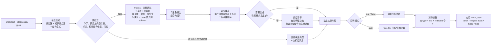

# AnyPII

[English](README.md) | 简体中文

**任意自然语言策略驱动的个人身份信息（PII）脱敏。只读判定，不生成文本。**

AnyPII 是一个本地 C++ 文本脱敏服务，基于
[llama.cpp](https://github.com/ggml-org/llama.cpp)。每次请求由调用方提供原文、
一段用自然语言写成的策略，以及一组带说明的类型定义。策略原样作为上下文使用，
不会被解析成固定规则；类型也完全由请求定义。

AnyPII 首先定位候选片段，再从受限的下一个 token 分数中读取每个片段的类型和打码
决定，最后返回脱敏文本和结构化片段。主路径仅执行预填充（prefill）：所有候选共享
同一段上下文前缀，每个唯一候选对应一条分支，按批进行多序列解码，生成的 token 数
始终为零。`redacted_text` 由原文按返回的片段拼接得到，不经过模型生成。

默认使用 CPU 推理，也可以按需启用 CUDA、Vulkan、ROCm 或 Metal。

## 快速开始

构建并启动服务：

```sh
./build.sh
./run.sh --model /path/to/Qwen3.5-0.8B-Q8_0.gguf --port 8080
```

以下请求使用五个由调用方定义的类型，对一段医疗文本进行脱敏：

```sh
curl -s http://127.0.0.1:8080/v1/anypii \
  -H 'Content-Type: application/json' \
  -d '{
    "state": {
      "text": "患者陈思远因肺炎入院。主治医师林婉清、责任护士周雅琴。予阿莫西林（商品名阿莫仙，辉瑞制药）抗感染。",
      "policy": "打码患者姓名；不要打码医生与护士姓名；打码药厂名、药物品牌名与商品名；保留药品通用名。"
    },
    "types": {
      "patient_name": {"description": "患者或患儿的姓名，不是医务人员。", "redact": true},
      "clinician_name": {"description": "医生、护士、药师等医务人员姓名。", "redact": false},
      "pharma_company": {"description": "药厂、制药企业名称。", "redact": true},
      "drug_brand": {"description": "药品品牌名、商品名、商标名。", "redact": true},
      "drug_generic": {"description": "药品通用名、成分名、INN。", "redact": false}
    },
    "threshold": 0.55,
    "mask_style": "token"
  }'
```

```json
{
  "redacted_text": "患者[REDACTED]因肺炎入院。主治医师林婉清、责任护士周雅琴。予阿莫西林（商品名[REDACTED]，[REDACTED]）抗感染。",
  "spans": [
    {"type": "patient_name",   "text": "陈思远",         "redacted": true,  "occurrences": [{"start": 2,  "end": 5,  "score": 0.995}]},
    {"type": "clinician_name", "text": "主治医师林婉清", "redacted": false, "occurrences": [{"start": 11, "end": 18, "score": 0.952}]},
    {"type": "clinician_name", "text": "责任护士周雅琴", "redacted": false, "occurrences": [{"start": 19, "end": 26, "score": 0.692}]},
    {"type": "drug_generic",   "text": "阿莫西林",       "redacted": false, "occurrences": [{"start": 28, "end": 32, "score": 0.962}]},
    {"type": "drug_brand",     "text": "阿莫仙",         "redacted": true,  "occurrences": [{"start": 36, "end": 39, "score": 0.899}]},
    {"type": "pharma_company", "text": "辉瑞制药",       "redacted": true,  "occurrences": [{"start": 40, "end": 44, "score": 0.798}]}
  ],
  "model": "qwen35 0.8B Q8_0",
  "backend": "qwen35 0.8B Q8_0 / llama.cpp CPU",
  "usage": {"decodes": 2, "branches": 16, "generated_tokens": 0, "fallback": false,
            "readout": {"cache_status": "miss", "cache_entries": 1, "checkpoint_bytes": 23637148},
            "result_cache": {"status": "miss", "entries": 1}}
}
```

`POST /v1/anypii` 是唯一的推理端点；`GET /health` 用于查询已加载的模型。传入
`--api-key KEY` 后，请求必须携带 `Authorization: Bearer KEY`。

请求字段保持稳定：`state.text`、`state.policy`、`types`、`threshold`、
`mask_style`，以及可选的 `skip_keep_types`、`omit_keep_spans`、`mode` 和
`parrot_typed`。

`examples/medical-long.json` 在八段文本中重复同一名患者和同一种药物。响应会按
`(type, text, redacted)` 合并重复出现，并在 `occurrences` 中列出全部位置。
`mask_style: "typed"` 使用 `[type:index]` 代替 `[REDACTED]`。

## 实现

推理仅执行预填充，不存在自回归循环，也不会由模型写出 `redacted_text`。一次请求依次
经过五个阶段：

1. **候选生成。** 中文文本由 cppjieba 提供词边界和词性，相邻词会合并，以恢复
   多词姓名。词典不可用时回退到模型 tokenizer。拉丁文本按字符类切分，相邻的
   首字母大写单词会合并为一个候选。结构模式覆盖邮箱、URL、电话号码、
   SSN/ITIN/EIN、支付卡（Luhn）、IBAN（mod-97）、IPv4/IPv6、NPI/MBI/DEA/VIN、
   护照号、AWS access key、中国大陆/香港/澳门/台湾身份证、各地区电话号码、
   工单号/订单号、API key、案号和出生日期。较长的纯数字串和长随机串也会作为
   候选。

   预过滤会排除单字、与调用方类型 id 或说明相似的标签词和缩写、类型说明中的
   短前缀或短后缀、跨越标点的片段、紧邻结构化值的短词，以及首词、尾词或内部
   词性属于弱边界的 CJK 片段。
   在合并后的 CJK 片段中，`x`、`nr`、`nrfg` 只能出现在最后一个词；从而去掉
   `陈思远体温`、`林婉清建议` 等过度合并，同时保留 `主治医师林婉清`。
   jieba 只用于生成候选，不承担最终分类。

2. **Pass A：类型读取。** 每个唯一候选对应一条分支，追加在共享上下文前缀之后。
   前缀包含原文、策略和类型说明。分支结束于 assistant 的判定位置，下一个 token
   的 logits 被限制为本次请求的类型代码加 `none`；对这些 logits 执行 softmax，
   即可得到类型分布。短片段还必须比 `none` 高出 `--none-margin`（默认 0.65）。
   重复出现的短候选共用一条分支。

3. **边界裁决。** 重叠候选组成一个组件。每个组件最多取两个选项：权重最高的
   选项和一个较长的合理变体，分别按正序和反序比较。随后应用完整性校正：如果
   较长的候选是当前结果的严格超串，且权重仍然接近，则选择更完整的片段。
   `患者陈思远`、`陈思远` 和 `患者` 等情况由此确定。

4. **类型精修。** 对仍有歧义的片段进行成对类型读取。候选类型来自 Pass A 的
   最佳类型和次佳类型、精确数字长度（`18位`、`16-19位`），以及调用方说明中
   两字以上的公共子串（例如 `辉瑞制药` 与 `药厂、制药企业`）。高置信片段和
   已由类型说明确定类型的片段会跳过该阶段。

5. **打码判定。** `redact: true/false` 强制生效。只有 `"auto"` 类型才会执行
   redact/keep 读取（Pass C）；如果所有类型都已明确指定，则完全跳过 Pass C。

各分支共享已经解码的上下文前缀。第 0 条序列（sequence 0）在多个阶段之间保留前缀
的键值缓存（KV），分支序列复制这段前缀后，只追加各自的分支尾部，并按批进行多序列
解码（`--max-branches`，默认 32）。整个流程不会为每个 token 或每个候选单独
执行一次前向。



坐标以原始字符串为基准：`start` 和 `end` 是 Unicode 码点（code point）下标，区间为
半开区间 `[start, end)`。各出现位置互不重叠，并按 `start` 升序排列。相同
`(type, text, redacted)` 的多次出现会合并为一个片段。

## 快速路径

当请求本身已经能够确定结果时，不调用模型：

| 路径 | 条件 | 模型调用 |
| --- | --- | --- |
| 格式 | 正则命中的规范格式名恰好匹配一个类型 id 或说明（邮箱、电话、SSN、ITIN、EIN、支付卡、IBAN、IP、URL、API key、工单号、案号、出生日期、NPI、MBI、DEA、VIN、护照号、AWS access key、中国大陆/香港/澳门/台湾身份证） | 0 |
| 长度 | 纯数字候选的长度只出现在一个类型说明中（`18位身份证号`、`16-19位银行卡号`） | 0 |
| 高置信 | Pass A 的概率和领先幅度达到跳过阈值 | 类型精修 0 次 |
| 说明匹配 | 长度或两字以上的说明重叠已经足以确定类型 | 类型精修 0 次 |
| `skip_keep_types` | 已启用，且组件的候选全部为 `redact:false` 类型 | 该组件 0 次 |
| 全部保留 | 已启用 `skip_keep_types`，且所有类型均为 `redact:false` | 总共 0 次 |

`skip_keep_types` 不会从 Pass A 中删除保留类型标签；这些标签仍作为对照项存在，
以免保留实体被误判为打码类型。该选项会跳过仅含保留类型的组件的边界裁决和类型
精修，省略这些组件的输出，并直接处理与格式匹配的保留候选（例如工单号），不产生
片段。如果所有类型都是保留类型，则直接返回原文，不执行解码。

### 地区格式

结构化快速路径覆盖：

- 中国大陆 18 位居民身份证，包括 MOD 11-2 校验和日期校验。
- 香港身份证（`A123456(3)`，带校验位）。
- 澳门身份证（`1234567(8)`，七位数字加括号中的校验位）。
- 台湾身份证（字母加九位数字，带校验和）。
- 中国手机号码（`+86` 可省略）、中国固话带或不带区号
  （`010-12345678`、`0755-12345678`、`12345678`、`1234567`）、香港
  （`+852`）、澳门（`+853`）、台湾（`+886`，手机或固话）。

类型 id 或说明中包含规范名称即可，例如 `cn_id`、`hkid`、`macau_id`、`twid`
或 `phone`。定义 phone 类型时，不带区号或分隔符的七位或八位本地号码会作为电话
候选；它们也可能是订单号，请结合业务策略确认。

## 词性过滤

中文候选边界使用 jieba 词性。默认情况下，以下标签（以及单字符标签对应的子类）
属于弱边界：

`v`（动词）、`a`（形容词）、`d`（副词）、`p`（介词）、`r`（代词）、
`u`（助词）、`m`（数词）、`q`（量词）、`t`（时间词）、`f`（方位词）、
`c`（连词）、`y`（语气词）、`e`（叹词）、`o`（拟声词）、`z`（状态词）、
`l`（习用语）、`i`（成语）、`w`（标点）、`b`（区别词）、`g`（语素）、
`h`（前接成分）、`k`（后接成分）。

- `v` 覆盖 `vd`、`vg`、`vi`、`vn`、`vq`；`u` 覆盖 `ud`、`ug`、`uj`、`ul`、
  `uv`、`uz`。`a`、`d`、`m`、`r`、`t` 的处理方式相同。
- 多字符的自定义标签按精确匹配处理（例如 `vn` 不会降权其他动词子类）。
- 默认保持强边界：`n`（名词）、`ng`（名词性语素）、`nr`（人名）、
  `nrfg`（人名子类）、`nrt`（音译人名）、`ns`（地名）、`nt`（机构团体名）、
  `nz`（其他专名）、`j`（简称）、`s`（处所词）、`x`（未知词或非语素，常为
  人名）、`eng`（英文）。

启动时可通过以下参数调整：

```sh
# 追加标签
./build/anypii --weak-pos vn,uj ...

# 覆盖默认值
./build/anypii --weak-pos-override v,n ...

# 清空弱边界集合
./build/anypii --weak-pos-override none ...
```

环境变量 `ANYPPI_WEAK_POS` 和 `ANYPPI_WEAK_POS_OVERRIDE` 可以设置相同的值。

## 缓存与延迟

共享上下文前缀是主要开销。每次请求只解码一次，并保留在第 0 条序列中；每条分支
复制这段前缀的 KV 缓存，只追加较短的分支尾部。类型读取、边界裁决、类型精修和打码
判定都使用同一段前缀，因此在不同阶段之间切换时不会重复预填充。
`ANYPPI_TIMING=1` 会打印前缀长度、分支数、批处理 token 数以及预填充和批处理
耗时。以 `medical-long.json` 为例：

```text
prefix_tokens=556 branches=34 batch_tokens=4472 prefill_ms=883 batch_ms=6323
prefix_tokens=556 branches=6  batch_tokens=928  prefill_ms=0   batch_ms=1229
```

第二行的 `prefill_ms=0` 说明命中了前缀缓存。前缀检查点还会跨请求保留在内存中的
有界 LRU（最近最少使用）缓存中（`--readout-cache-entries` 默认 4，
`--readout-cache-bytes` 默认 256 MiB）。PCD 使用独立的检查点缓存。

完全相同的请求会直接命中结果缓存，不执行任何推理。缓存键包含模型名、原文、
策略、有序类型定义、threshold、`mask_style`、`skip_keep_types`、
`omit_keep_spans`、`mode`、`parrot_typed` 和 `fallback`。结果缓存只保存输出，
不保存 KV 状态，并受条目数和字节数限制（`--result-cache-entries` 默认 64，
`--result-cache-bytes` 默认 64 MiB）。命中时
`usage.result_cache.status = "hit"`，`decodes = 0`，且响应中不会出现
`usage.readout` 或 `usage.pcd`。

候选生成有独立的小型缓存，PCD 的类型阶段也有有界的类型预判缓存；两者都不能替代
结果缓存。

CPU 调优方面，`--threads` 默认使用物理核心数。增加线程数不一定更快：超过一定
数量后，调度和同步开销可能抵消收益，实际表现取决于 CPU 和负载。调大
`--n-batch`、`--n-ubatch` 或 `--ctx` 同样没有稳定收益。建议从默认值开始，
并在您的设备上验证实际收益。

如果把分支专属内容从尾部移入前缀，各分支的前缀将不同，从而使共享缓存失效。
这一布局是有意设计的：一段公共上下文前缀，加上较短的分支尾部。

## 读出布局与分支裁剪

标准类型分支布局是生产环境默认值。以下 A/B 选项以减少分支为目标，但需要自行
验证准确率：

| 选项 | 默认 | 作用 | 注意事项 |
| --- | --- | --- | --- |
| `--compact-branches` | 关闭 | 缩短类型分支的说明文字 | 在一次 A/B 测试中，`medical-long.json` 从约 9.7 秒降到 7.9 秒，但 `legal.json` 遗漏了人员片段；`medical.json` 则更慢，约 3.6 秒 |
| `--single-type-orientation` | 关闭 | 类型精修分支减半 | 长文档中部分片段会发生变化 |
| `--no-type-refine-dedup` | 开启去重 | 按每次出现分别进行类型精修 | 分支更多；同一字面量在不同语境下需要不同类型时使用 |
| `--component-shortlist` | 关闭 | 每个组件只保留最长片段、权重最高的选项、最短后缀和正则命中 | 可能移除本身合法的短前缀，例如公司名中的地名 |

类型精修会按“重复文本 + 候选类型短名单”去重，复用第一次判定，使重复实体得到
一致的类型和打码决定。在 `medical-long.json` 示例中，分支数从 62 降到 48
（约 12.4 秒降到 9.8 秒），类型精修对数从 10 降到 3。风险在于依赖语境的
同形异义：相同文本在不同角色下可能需要不同类型。候选类型短名单不同时不会
去重，但仍无法覆盖所有同形异义；如果策略要求同一字面量按语境使用不同
类型，请关闭去重。需要注意，“一致”不等于“正确”：重复复用也可能稳定地
产生同一错误。

当边界裁决的两个选项类型相同且都是保留类型，或某个片段的所有候选类型都是保留
类型时，会跳过对应分支。引擎保留最长的完整片段和 Pass A 的最佳类型，这不会改变
打码决定。

`--component-shortlist` 会在类型阶段按重叠组件裁剪：保留最长片段、权重最高的
选项、最短后缀和正则命中，并丢弃职务称谓等公共前缀。`medical.json` 的类型分支
从 16 降到 10（约 2.9 秒降到 1.7 秒）；`medical-long.json` 从 48 降到 40
（约 9.5 秒降到 8.0 秒）。该选项默认关闭；短前缀本身也可能是合法实体，例如
公司名中的地名。

## 温度与置信度

`--temperature` 会在 softmax 之前缩放受限的 logits。它影响读出路径、PCD 的
选项打分，以及 PCD 用作参考的读出概率。常用范围：

- `0.85–0.95`：精确率更高，边缘保留片段更少，但可能漏检歧义姓名或证件号。
- `1.0`：默认值。
- `1.1–1.3`：召回率更高，但误保留片段和过度扩展也会增加。

请与 `--none-margin`（保留类型）、`--none-margin-redact`（`redact:true` 类型）
以及请求级 `threshold` 配合调整。`--none-margin-max-len` 只对不超过指定长度
的片段应用边界差值检查（默认 4 个码点）。修改后请重新运行示例或测试。

## 实验性 PCD 路径

设置 `"mode": "pcd"` 可以启用并行约束解码（Parallel Constrained Decoding）
后端，代码改编自 [pcdServer](https://github.com/stephanj/pcdServer)。它将决策
渲染成有界字段，每个字段对应一条序列，只对允许的选项 token 打分，并通过冲突树
解决共享 token 前缀，同时缓存前缀检查点（`--pcd-cache-entries`、
`--pcd-cache-bytes`）。

默认模式仍是 `"readout"`。PCD 在缓存命中时速度最快，并使用读出阶段的类型概率
作为置信门控和类型参考。它与 `readout` 在 `medical.json` 和 `legal.json` 上结果
一致；占位名仍可能使部分标签提及扩展过长。因此它主要用于重复的字段结构和基准
测试。PCD 响应包含 `usage.pcd`，其中有前向次数、缓存状态、检查点字节数、
类型预判缓存命中数和各阶段耗时。

### Parrot / 复读机模式

`mode: "parrot"`（别名 `"复读机"`）是不分类的 token 级 PCD 原型。它为每个
token 建立一个字段，选项为 `copy` 或 `REDACTED`，连续的 REDACTED token 会合并，
返回类型 `"redacted"`。`types` 可以省略；未启用 `parrot_typed` 时会被忽略。
文本必须能由 tokenizer 还原，且不超过 256 个 token。

设置 `parrot_typed: true` 后，每个 token 的选项变为 `copy` 加请求中的类型 id；
连续的同类型 token 会合并成带类型的片段。`mask_style: "type"` 输出 `[type]`，
`"typed"` 输出 `[type:index]`。

当前 0.8B 模型会明显过度打码；2B 模型在温度 0.7–1.3 下要么过度打码，要么全部
复制，typed 2B 通常复制所有 token。因此该模式仅用于对比和基准测试，不推荐用于
生产环境。请使用 `readout` 或 `pcd`。

## 构建

需要 CMake 3.20+、Git 和支持 C++20 的编译器。官方 llama.cpp **v1.0.0** 和
cppjieba 已作为子模块固定，无需额外检出。cppjieba 词典位于
`third_party/cppjieba/dict`；可用 `ANYPPI_JIEBA_DICT` 指向其他词典目录。

```sh
git clone --recurse-submodules https://github.com/DreamBlooms/AnyPii-Readout.git
cd AnyPii-Readout
./build.sh

# 已有检出：
git submodule update --init --recursive
./build.sh

# 或指向另一个上游 llama.cpp 检出：
cmake -S . -B build -DCMAKE_BUILD_TYPE=Release -DGGML_NATIVE=ON \
  -DLLAMA_DIR=/path/to/llama.cpp
cmake --build build -j"$(nproc)"
```

llama.cpp 和 ggml 采用静态链接，最终得到单个 `build/anypii` 可执行文件，约
7 MB。

### GPU

默认构建仅支持 CPU。可以在配置阶段启用一个可选后端：

```sh
cmake -S . -B build -DCMAKE_BUILD_TYPE=Release -DANYPPI_CUDA=ON
cmake --build build -j"$(nproc)"
```

`ANYPPI_CUDA`、`ANYPPI_VULKAN`、`ANYPPI_HIP` 和 `ANYPPI_METAL` 分别对应
llama.cpp 的 `GGML_*` 后端。运行时通过 `--gpu-layers -1` 卸载全部层，或用正整数
指定层数；`--gpu-layers 0` 保持 CPU。同一套命令行适用于纯 CPU 和 GPU 构建。
CUDA 交叉编译时，可用 `-DCMAKE_CUDA_ARCHITECTURES=89` 指定目标架构。

## 启动参数

```text
--model PATH        GGUF 模型（默认 $ANYPPI_MODEL 或本机 Qwen3.5-0.8B）
--host HOST         绑定地址（默认 127.0.0.1）
--port N            端口（默认 8080）
--ctx N             上下文大小（默认 65536）
--threads N         CPU 线程数（默认使用物理核心数）
--n-batch N         逻辑批大小（默认 8192）
--n-ubatch N        物理批大小（默认 1024）
--gpu-layers N      卸载到 GPU 的层数（0 = CPU，负数 = 全部；GPU 构建）
--flash-attn MODE   auto|on|off（默认 auto）
--max-branches N    单次解码的最大分支数（默认 32）
--max-text-cp N     输入文本最大码点数（默认 16000）
--max-candidates N  最大候选片段数（默认 4000）
--temperature T     softmax 温度（默认 1.0）
--none-margin M     最小 P(type)-P(none) 差值（默认 0.65）
--none-margin-max-len N  仅对不超过 N 个码点的片段应用该差值（默认 4）
--none-margin-redact M   redact:true 类型的最小差值（默认 0.20）
--pcd-cache-entries N    PCD 前缀检查点条目数（默认 4）
--pcd-cache-bytes BYTES  PCD 前缀检查点预算（默认 256 MiB）
--readout-cache-entries N  读出阶段前缀检查点条目数（默认 4）
--readout-cache-bytes BYTES 读出阶段前缀检查点预算（默认 256 MiB）
--weak-pos LIST     追加 jieba 弱边界词性标签
--weak-pos-override LIST  覆盖弱边界词性集合（none 表示清空）
--result-cache-entries N  缓存相同请求的结果数（默认 64）
--result-cache-bytes BYTES  结果缓存预算（默认 64 MiB）
--compact-branches  使用更短的类型分支说明（A/B）
--single-type-orientation  类型精修只使用一个方向（A/B）
--type-refine-dedup       按文本和类型短名单去重类型精修（默认开启）
--no-type-refine-dedup    按每次出现分别进行类型精修（A/B）
--component-shortlist  每个组件仅对最长片段、最高权重选项和后缀选项判定类型（A/B）
--api-key KEY       要求 Authorization: Bearer KEY
--help              显示帮助
```

## API

请求字段：

| 字段 | 含义 |
| --- | --- |
| `state.text` | 原文 |
| `state.policy` | 任意自然语言策略，可以为空 |
| `types` | 类型 id 到类型定义的映射；`readout` 和 `pcd` 模式必填，`parrot` 模式可省略 |
| `types.*.description` | 类型说明 |
| `types.*.redact` | `true`/`false` 强制指定；省略或设为 `"auto"` 时由读出判定 |
| `threshold` | 可选，默认 `0.55` |
| `mask_style` | `"token"`（`[REDACTED]`）、`"length"`（每个码点一个 `█`）、`"type"`（`[type]`）或 `"typed"`（`[type:index]`）；`"mask"` 是 length 的别名 |
| `skip_keep_types` | 可选；跳过仅含保留类型的探测、精修和输出 |
| `omit_keep_spans` | 可选；从响应中省略 `redacted:false` 的片段，原文不变 |
| `parrot_typed` | 可选；parrot 模式下用类型 id 代替 `REDACTED` 作为 token 选项，需要 `types` |
| `mode` | `"readout"`（默认）、`"pcd"`（实验性）或 `"parrot"`（实验性 token 级） |
| `fallback` | 可选；为将来的约束解码路径保留 |

响应字段：

| 字段 | 含义 |
| --- | --- |
| `redacted_text` | 将打码片段替换后的文本 |
| `spans[]` | `{type, text, redacted, occurrences: [{start, end, score[, redact_score]}]}` |
| `model`、`backend` | 已加载的模型和计算后端 |
| `usage` | `{decodes, branches, generated_tokens, fallback[, readout][, pcd][, result_cache]}` |

`score` 是读出和裁决得到的置信度，包含请求中类型说明和长度信息的影响，并非校准概率。
`redact_score` 只在 `"auto"` 类型上出现。相同 `(type, text, redacted)` 的多次
出现会合并为一个片段；`mask_style: "typed"` 中的 `index` 是该片段在 `spans[]`
中的零基下标。

`usage.decodes` 是流水线统计的解码轮次数：每个判定阶段计一次前缀轮次，再加上
分支批次；`usage.branches` 统计判定分支数。两者都不是生成 token 数，
`generated_tokens` 始终为零。前缀缓存命中时，`decodes` 仍会按上述口径计入一次
前缀轮次。

打码语义：

| `redact` | 行为 |
| --- | --- |
| `true` | 该类型的所有命中都会打码 |
| `false` | 该类型的所有命中都会保留，但仍会出现在 `spans` 中 |
| 省略或 `"auto"` | 根据策略执行打码/保留读取；`redact_score = P(redact)` |
| 策略冲突 | 显式 `redact` 优先 |

## 测试

```sh
python3 tests/test_anypii.py
```

测试脚本会在随机端口自行启动和停止服务，覆盖：

- 医疗与联系信息的精确输出；
- NIST 和地区格式的零解码快速路径（SSN、ITIN、EIN、支付卡、IBAN、IPv6、
  出生日期、NPI、MBI、DEA、VIN、护照号、AWS access key、中国大陆/香港/澳门/
  台湾身份证和地区电话）；
- `readout` 与 PCD 的前缀检查点缓存命中；
- parrot 模式的完整流程、typed parrot 和 `mask_style: "type"`；
- 相同请求的结果缓存和 PCD 类型预判缓存；
- `omit_keep_spans` 的输出过滤；
- `redact` 翻转；
- 等长遮罩和 typed 遮罩；
- auto 打码；
- 重复出现合并，以及 14.4k 字符的长文本输入；
- `skip_keep_types` 和全部保留时零解码的快捷路径；
- 空文本和非法 threshold（HTTP 400）。

如果服务已在运行：

```sh
ANYPPI_URL=http://127.0.0.1:8080 python3 tests/test_anypii.py
```

调试时，`ANYPPI_DEBUG=1` 会输出候选和各判定阶段的信息，
`ANYPPI_TIMING=1` 会输出前缀和分支耗时。

## 限制

- 只输出互不重叠的片段；嵌套实体不会作为独立命中返回。
- `李四`、`李小明` 等占位名会降低 0.8B 模型和 jieba 的边界与类型准确率。
- 单次 `readout` 请求最多支持 25 个类型，受选项标签预算限制。
- 默认文本上限为 16000 个码点，候选上限为 4000
  （`--max-text-cp`、`--max-candidates`）；超出时返回 400。HTTP 请求体上限为
  2 MiB。
- 0.8B 模型在细粒度的自定义类型上置信度有限；更清晰的说明和合适的
  threshold 有助于改善结果。
- 中文候选生成依赖 cppjieba 的词和词性信息；词典不可用时回退到模型 tokenizer。
  类型标签来自调用方的类型 id 和说明。
- `skip_keep_types` 用于减少不必要的判定。它仍在 Pass A 中保留 `redact:false` 类型的
  标签，以避免误打码，因此节省的是边界裁决、类型精修和输出，而不是类型读取阶段。
- 本地 HTTP 服务不提供 TLS。对外部署时应放在反向代理之后，并启用 `--api-key`。
- `fallback` 字段目前保留，尚未实现约束解码路径。
- 类型精修去重和 `--component-shortlist` 都是近似优化；在您的数据上验证后再
  广泛启用。
- PCD 和 parrot 模式属于实验性功能；默认应使用 `readout`。

## 致谢

架构和提示词布局参考 System One / logit 读出路线：
[ifreflex.cpp](https://github.com/DreamBlooms/ifreflex.cpp)、
[reflex](https://github.com/kshetrajna12/reflex) 和
[SemIf-OpenJev](https://github.com/TheoLeeCJ/SemIf-OpenJev)。AnyPII 是面向
任意自然语言策略驱动 PII 脱敏的独立实现。

第三方组件：

- [llama.cpp](https://github.com/ggml-org/llama.cpp)（MIT）
- [cppjieba](https://github.com/yanyiwu/cppjieba)（MIT）
- [cpp-httplib](https://github.com/yhirose/cpp-httplib)（MIT）
- [nlohmann/json](https://github.com/nlohmann/json)（MIT）

PII 格式正则参考并交叉验证了
[trackingplan/pii-regex-library](https://github.com/trackingplan/pii-regex-library)
（MIT）和 PII Crawler 的正则指南。

默认模型为 Qwen3.5-0.8B；模型权重是独立产物，适用其各自的许可条款。

## 许可证

MIT。见 [LICENSE](LICENSE)，第三方声明见 [NOTICE](NOTICE)。
