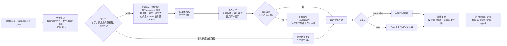

# AnyPII

[English](README.md) | 简体中文

**任意自然语言策略驱动的 PII 脱敏。仅读取 logits。不生成文本。可选纯 CPU 推理。**

基于 [llama.cpp](https://github.com/ggml-org/llama.cpp) 的本地 C++ 文本脱敏服务。
调用方在每次请求中提供原文、任意自然语言策略和一组自定义类型。策略与类型完全由
请求定义；策略原样进入共享 evidence 上下文，不解析为固定规则语法。AnyPII 负责
发现片段，从受限 next-token logits 读取类型与打码判定，并返回打码文本和结构化
spans。

主路径仅执行 prefill。所有候选共享 evidence 前缀，每个候选对应一条分支；分支按批
进行多序列 decode，生成的 token 数为零。`redacted_text` 由原文按 spans 拼接得到。

## 任意自然语言策略，任意实体类型

构建并启动：

```sh
./build.sh
./run.sh --model /path/to/Qwen3.5-0.8B-Q8_0.gguf --port 8080
```

以下请求使用五个由调用方定义的类型，对一段医疗文本进行脱敏：

```sh
curl -s http://127.0.0.1:8080/v1/anypii \
  -H 'Content-Type: application/json' \
  -d '{
    "state": {
      "text": "患者陈思远因肺炎入院。主治医师林婉清、责任护士周雅琴。予阿莫西林（商品名阿莫仙，辉瑞制药）抗感染。",
      "policy": "打码患者姓名；不要打码医生与护士姓名；打码药厂名、药物品牌名与商品名；保留药品通用名。"
    },
    "types": {
      "patient_name": {"description": "患者或患儿的姓名，不是医务人员。", "redact": true},
      "clinician_name": {"description": "医生、护士、药师等医务人员姓名。", "redact": false},
      "pharma_company": {"description": "药厂、制药企业名称。", "redact": true},
      "drug_brand": {"description": "药品品牌名、商品名、商标名。", "redact": true},
      "drug_generic": {"description": "药品通用名、成分名、INN。", "redact": false}
    },
    "threshold": 0.55,
    "mask_style": "token"
  }'

```

```json
{
  "redacted_text": "患者[REDACTED]因肺炎入院。主治医师林婉清、责任护士周雅琴。予阿莫西林（商品名[REDACTED]，[REDACTED]）抗感染。",
  "spans": [
    {"type": "patient_name",   "text": "陈思远",         "redacted": true,  "occurrences": [{"start": 2,  "end": 5,  "score": 0.995}]},
    {"type": "clinician_name", "text": "主治医师林婉清", "redacted": false, "occurrences": [{"start": 11, "end": 18, "score": 0.952}]},
    {"type": "clinician_name", "text": "责任护士周雅琴", "redacted": false, "occurrences": [{"start": 19, "end": 26, "score": 0.633}]},
    {"type": "drug_generic",   "text": "阿莫西林",       "redacted": false, "occurrences": [{"start": 28, "end": 32, "score": 0.962}]},
    {"type": "drug_brand",     "text": "阿莫仙",         "redacted": true,  "occurrences": [{"start": 36, "end": 39, "score": 0.899}]},
    {"type": "pharma_company", "text": "辉瑞制药",       "redacted": true,  "occurrences": [{"start": 40, "end": 44, "score": 0.798}]}
  ],
  "model": "qwen35 0.8B Q8_0",
  "backend": "qwen35 0.8B Q8_0 / llama.cpp CPU",
  "usage": {"decodes": 6, "branches": 20, "generated_tokens": 0, "fallback": false,
            "readout": {"cache_status": "miss", "cache_entries": 1, "checkpoint_bytes": 23637148}}
}
```

`POST /v1/anypii` 是唯一的推理端点；`GET /health` 描述已加载模型。使用
`--api-key KEY` 可要求 `Authorization: Bearer KEY`。请求字段保持稳定：
`state.text`、`state.policy`、`types`、`threshold`、`mask_style`，以及可选的
`skip_keep_types`。

更长的 `examples/medical-long.json` 在八段文本中重复同一患者与辉瑞药物；响应会
按实体合并，并在 `occurrences` 中列出全部位置。`mask_style: "typed"` 会用
`[type:index]` 代替 `[REDACTED]`。

## 实现

推理仅执行 prefill，不存在自回归循环。一次请求经过五个判定阶段：

1. **候选生成。** 中文文本由 cppjieba 提供词边界与词性，并在相邻词之间合并以恢复
   多词姓名；词典不可用时回退到模型 tokenizer。拉丁文本按字符类切分并合并相邻词。
   候选还包括邮箱、URL、电话、长数字、工单/订单号、IPv4、API key、案号等正则例外。
   预过滤会排除单字、与调用方类型标签匹配的片段（类型 id/说明中的单词、缩写或
   2-6 字子串）、跨越标点的片段、紧邻结构化正则值的短词，以及首/尾/内部词性为
   动词、助词、介词、副词、数词、时间词等的 CJK 片段。拉丁多词姓名仅在两个词都
   大写时合并（Alice Johnson、Acme Corp）。jieba 仅作为候选先验，不承担最终分类。
2. **Pass A：类型判定。** 每个候选对应一条追加到共享 evidence 前缀（原文、策略
   与类型说明）的分支。分支结束于 assistant 判定位置；next-token logits 被限制到
   本次请求的类型代码加 `none`。对这些 logits 做 softmax，即得到类型分布；类型还必须
   比 `none` 高出 `--none-margin`（默认 0.65）。
3. **边界判定。** 重叠候选构成一个组件。对最强候选与最长合理变体分别按正序和
   反序进行成对比较；若胜者是另一候选的严格子串且两者权重接近，则选择更长的
   完整片段。用于区分 `患者陈思远`、`陈思远` 与 `患者`。
4. **类型精修。** 对歧义片段进行类型成对读取。候选类型由调用方提供的说明驱动：
   精确数字长度（`18位`、`16-19位`）以及 2 字以上公共子串
   （`辉瑞制药` 与 `药厂、制药企业`）。高置信片段及可由先验确定的类型跳过该阶段。
5. **打码判定。** `redact: true/false` 强制生效。仅 `"auto"` 类型执行
   redact/keep readout（Pass C）；若所有类型均为显式 true/false，则完全跳过
   Pass C。

各分支共享已解码的 evidence 前缀；sequence 0 在多个阶段间保留前缀 KV，
分支按批进行多序列 decode（`--max-branches`，默认 32）。推理不按 token 逐个
执行，也不为每个候选单独执行前向。



共享前缀是主要开销：每次请求只解码一次，每个判定只追加很短的 branch tail。
所有阶段都只做 prefill，因此开销随判定分支数量增长，而不随生成 token 数增长。

坐标以原始字符串为基准：`start`/`end` 是 Unicode **code point** 下标，半开区间
`[start, end)`。出现位置互不重叠，并按 `start` 升序排列；同一 `(type, text,
redacted)` 的多次出现会合并为一个 span。

## 快速路径

当结果可由请求直接确定时，不调用模型：

| 路径 | 条件 | 模型调用 |
| --- | --- | --- |
| 格式 | 正则命中的 NIST 格式名恰好匹配一个类型 id/说明（邮箱、电话、SSN、ITIN、EIN、支付卡、IBAN、IP、URL、API key、工单、案号、出生日期） | 0 |
| 长度 | 数字候选的长度恰好出现在唯一类型说明中（`18位身份证号`、`16-19位银行卡号`） | 0 |
| 高置信 | Pass A 的概率与领先幅度达到跳过阈值 | 类型精修 0 次 |
| 描述先验 | 长度或 2 字以上描述重叠已足以确定类型 | 类型精修 0 次 |
| `skip_keep_types` | 为 true 且组件全部由保留类型构成 | 该组件 0 次 |
| 全部保留 | `skip_keep_types` 为 true 且所有类型均为保留类型 | 总共 0 次 |

`skip_keep_types` 不会从 Pass A 中删除保留类型标签：这些标签仍作为对照项存在，
以免保留实体被误判为打码类型。该选项跳过仅含保留类型的组件的边界与类型精修，
并省略其输出，同时直接跳过格式匹配的保留类型候选（例如工单号），不产生 span。
若所有类型均为保留类型，则直接返回原文，不执行 decode。

## 温度与置信度

`--temperature` 会在 softmax 前缩放受限 logits。它影响 readout 路径、PCD 的
choice 打分，以及 PCD 使用的 readout 先验。建议起点：

- `0.85–0.95`：更高的精确率，减少边缘 keep span，但可能漏掉歧义姓名或 ID。
- `1.0`：默认值。
- `1.1–1.3`：更高召回，但会增加误保留 span 和过度扩展。

请与 `--none-margin`（保留类型）、`--none-margin-redact`（`redact:true` 类型）
以及请求级 `threshold` 配合调整；修改后重新跑 examples 或测试。

## 实验性 PCD 路径

设置 `"mode": "pcd"` 可启用从 [pcdServer](https://github.com/stephanj/pcdServer)
适配的并行约束解码后端。它把决策渲染为有界字段，每个字段一条 sequence，
只对允许的 choice token 打分，用 collision tree 消歧共享 token 前缀，并缓存
prefix checkpoint（`--pcd-cache-entries`、`--pcd-cache-bytes`）。其类型阶段
使用 readout 类型判定作为置信门控与先验，抑制对非实体片段的过度分类。

默认仍为 `"readout"`。PCD 在缓存命中时最快，并使用 readout 类型概率作为
置信门控与先验；在真实姓名下，medical/legal 示例与 readout 结果一致，但占位名
仍可能把部分标签提及扩展过长。因此它主要用于重复 schema 和基准测试。该模式的
响应包含 `usage.pcd`（forward passes、缓存状态、checkpoint 字节数与阶段耗时）。readout 请求通过
`--readout-cache-entries`、`--readout-cache-bytes` 暴露有界前缀 checkpoint LRU，
状态在 `usage.readout` 中。

### Parrot / 复读机模式

`mode: "parrot"`（别名 `"复读机"`）是不分类的 token 级 PCD 原型：每个 token
一个 field，choices 为 `copy` / `REDACTED`，连续 REDACTED token 会合并，返回
type `"redacted"`。`types` 可省略；未启用 `parrot_typed` 时会被忽略。文本必须
可由 tokenizer 还原，且不超过 256 个 token。

设置 `parrot_typed: true` 后，每个 token 的 choices 变为 `copy` 加请求中的
类型 id；连续同类型 token 会合并为带类型的 span。`mask_style: "type"` 输出
`[type]`，`"typed"` 输出 `[type:index]`。

当前 0.8B 会明显过度打码；2B 在温度 0.7–1.3 下要么过度打码、要么全部 copy，
typed 2B 倾向于全部 copy。因此该模式仅作为对比/基准保留，不推荐生产使用；
请使用 `readout` 或 `pcd`。

## 构建

需要 CMake 3.20+、Git 和 C++20 编译器。官方 llama.cpp **v0.6.0** 与 cppjieba
已作为子模块固定，无需外部 checkout。cppjieba 词典位于
`third_party/cppjieba/dict`；可用 `ANYPPI_JIEBA_DICT` 指向其他词典目录。

```sh
git clone --recurse-submodules https://github.com/DreamBlooms/AnyPii-Readout.git
cd AnyPii-Readout
./build.sh

# 已有 checkout：
git submodule update --init --recursive
./build.sh

# 或指向另一个上游 llama.cpp checkout：
cmake -S . -B build -DCMAKE_BUILD_TYPE=Release -DGGML_NATIVE=ON \
  -DLLAMA_DIR=/path/to/llama.cpp
cmake --build build -j"$(nproc)"
```

llama.cpp 与 ggml 静态链接，产物是单个 `build/anypii`（约 7 MB）。

### GPU

默认构建为纯 CPU。可在配置时启用一个可选后端：

```sh
cmake -S . -B build -DCMAKE_BUILD_TYPE=Release -DANYPPI_CUDA=ON
cmake --build build -j"$(nproc)"
```

`ANYPPI_CUDA`、`ANYPPI_VULKAN`、`ANYPPI_HIP`、`ANYPPI_METAL` 分别对应
llama.cpp 的 `GGML_*` 后端。运行时用 `--gpu-layers -1`（全部层）或正整数指定
offload 层数；`--gpu-layers 0` 保持 CPU。同一套命令行适用于纯 CPU 与 GPU 构建。
CUDA 交叉编译时可用 `-DCMAKE_CUDA_ARCHITECTURES=89` 指定目标架构。

## 启动参数

```
--model PATH        GGUF 模型（默认 $ANYPPI_MODEL 或本机 Qwen3.5-0.8B）
--host HOST         绑定地址（默认 127.0.0.1）
--port N            端口（默认 8080）
--ctx N             上下文大小（默认 65536）
--threads N         CPU 线程数（默认使用物理核心数）
--n-batch N         逻辑批大小（默认 8192）
--n-ubatch N        物理批大小（默认 1024）
--gpu-layers N      offload 层数（0 = CPU，负数 = 全部；GPU 构建）
--flash-attn MODE   auto|on|off（默认 auto）
--max-branches N    单次 decode 的最大分支数（默认 32）
--max-text-cp N     输入文本最大 code point 数（默认 16000）
--max-candidates N  最大候选片段数（默认 4000）
--temperature T     softmax 温度（默认 1.0）
--none-margin M     最小 P(type)-P(none) 置信差（默认 0.65）
--none-margin-max-len N  仅对不超过 N 个 code point 的片段应用置信差（默认 4）
--none-margin-redact M   redact:true 类型的最小置信差（默认 0.20）
--pcd-cache-entries N    PCD 前缀 checkpoint 条目数（默认 4）
--pcd-cache-bytes BYTES  PCD 前缀 checkpoint 预算（默认 256 MiB）
--readout-cache-entries N  readout 前缀 checkpoint 条目数（默认 4）
--readout-cache-bytes BYTES readout 前缀 checkpoint 预算（默认 256 MiB）
--api-key KEY       要求 Authorization: Bearer KEY
--help              显示帮助
```

## API

请求：

| 字段 | 含义 |
| --- | --- |
| `state.text` | 原文 |
| `state.policy` | 任意自然语言策略，可为空 |
| `types` | 类型 id 到定义的映射 |
| `types.*.description` | 类型说明 |
| `types.*.redact` | `true`/`false` 强制；省略或 `"auto"` 由 readout 判定 |
| `threshold` | 可选，默认 `0.55` |
| `mask_style` | `"token"`（`[REDACTED]`）、`"length"`（每个 code point 一个 `█`）、`"type"`（`[type]`）或 `"typed"`（`[type:index]`）；`"mask"` 是 length 的别名 |
| `skip_keep_types` | 可选；跳过仅含保留类型的探测、精修与输出 |
| `parrot_typed` | 可选；`parrot` 模式下用类型 id 作为 token choices，而不是 `REDACTED`（需要 `types`） |
| `mode` | `"readout"`（默认）、`"pcd"`（实验性）或 `"parrot"`/`"复读机"`（实验性 token 级） |
| `fallback` | 可选；为后续约束解码路径保留 |

响应：

| 字段 | 含义 |
| --- | --- |
| `redacted_text` | 打码后的文本 |
| `spans[]` | `{type, text, redacted, occurrences: [{start, end, score[, redact_score]}]}` |
| `model`, `backend` | 模型与计算后端 |
| `usage` | `{decodes, branches, generated_tokens, fallback[, readout][, pcd]}` |

`score` 是由 readout 与裁决得到的置信度，包含请求驱动先验的影响，并非校准概率。
`redact_score` 仅在 `"auto"` 类型时返回。同一 `(type, text, redacted)` 的多次出现
会合并为一个 span；`mask_style: "typed"` 中的 `index` 是该 span 在 `spans[]` 中的
0 基下标。

打码语义：

| `redact` | 行为 |
| --- | --- |
| `true` | 该类型的所有命中强制打码 |
| `false` | 该类型的所有命中保留，但仍会出现在 `spans` 中 |
| 省略或 `"auto"` | 根据策略执行 redact/keep 判定；`redact_score = P(redact)` |
| 策略冲突 | 显式 `redact` 优先 |

## 测试

```sh
python3 tests/test_anypii.py
```

测试脚本会在随机端口启动并停止服务，覆盖：

- 医疗与联系信息的精确输出；
- NIST 正则快速路径（SSN、ITIN、EIN、支付卡、IBAN、IPv6、出生日期），零 decode；
- readout 与 PCD 的 prefix-checkpoint 缓存命中；
- parrot/复读机 模式管线、typed parrot 与 `mask_style: "type"`；
- `redact` 翻转；
- 等长遮罩与 typed 遮罩；
- auto redact；
- 重复出现合并，以及 14.4k 字符的长文本输入；
- `skip_keep_types` 以及全部保留时零 decode 的快捷路径；
- 空文本与非法 threshold 的 HTTP 400 行为。

若服务已在运行：

```sh
ANYPPI_URL=http://127.0.0.1:8080 python3 tests/test_anypii.py
```

## 限制

- 仅输出互不重叠的 spans；嵌套实体不会作为独立命中返回。
- examples 使用真实姓名；`李四`、`李小明` 这类占位名会降低 0.8B 模型与
  jieba 的边界/类型准确率。
- 单请求最多支持 25 个类型，受选项标签数量限制。
- 默认文本上限为 16000 code points，候选上限为 4000（可通过 `--max-text-cp`、
  `--max-candidates` 调整）；超出时返回 400。
- 0.8B 模型在细粒度自定义类型上的置信度有限；更明确的 description 与合适的
  threshold 可改善结果。
- 中文候选生成使用 cppjieba 词/词性先验；词典不可用时回退到模型 tokenizer。
  标签来自调用方类型 id/说明。可通过 `--none-margin` 与 `--temperature`
  调整精确率/召回率。
- `skip_keep_types` 用于减少不必要的判定。它仍在 Pass A 中保留类型标签，以避免误打码，
  因此节省的是边界与类型精修及输出，而非类型判定阶段。
- 服务默认仅监听本地 HTTP；对外部署时应置于反向代理之后，并启用 `--api-key`。
- `fallback` 字段当前保留，尚未实现约束解码路径。

## 致谢

架构与提示词布局参考 System One / logit-readout 路线：
[ifreflex.cpp](https://github.com/DreamBlooms/ifreflex.cpp)、
[reflex](https://github.com/kshetrajna12/reflex)、
[SemIf-OpenJev](https://github.com/TheoLeeCJ/SemIf-OpenJev)。AnyPII 是面向任意自然语言策略的 PII 脱敏独立实现。

第三方组件：

- [llama.cpp](https://github.com/ggml-org/llama.cpp)（MIT）
- [cppjieba](https://github.com/yanyiwu/cppjieba)（MIT）
- [cpp-httplib](https://github.com/yhirose/cpp-httplib)（MIT）
- [nlohmann/json](https://github.com/nlohmann/json)（MIT）

默认模型为 Qwen3.5-0.8B；模型权重为独立产物，适用其各自许可条款。

## 许可证

MIT。见 [LICENSE](LICENSE)，第三方声明见 [NOTICE](NOTICE)。
